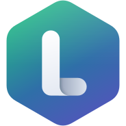
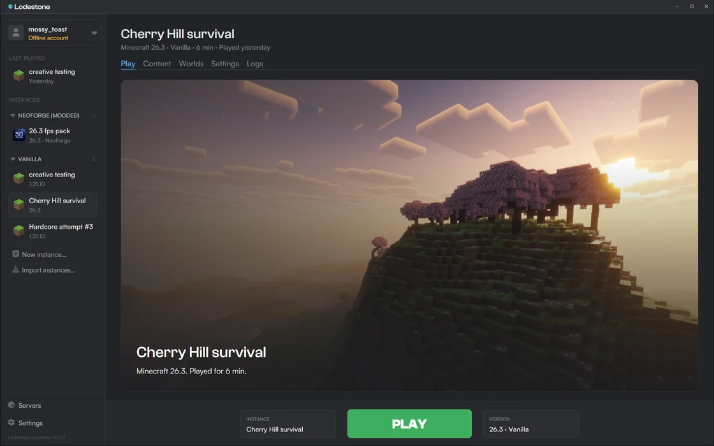
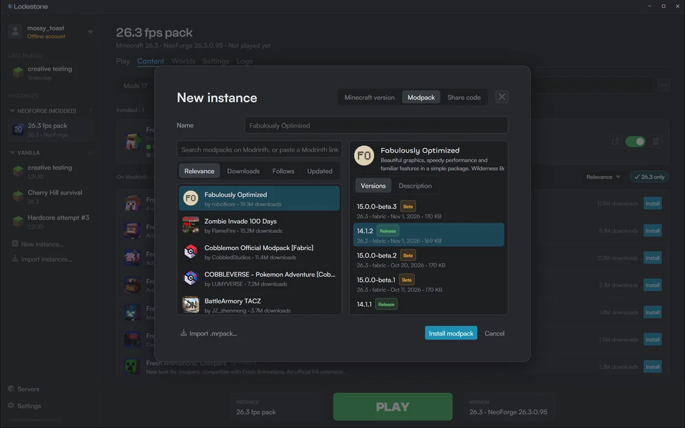
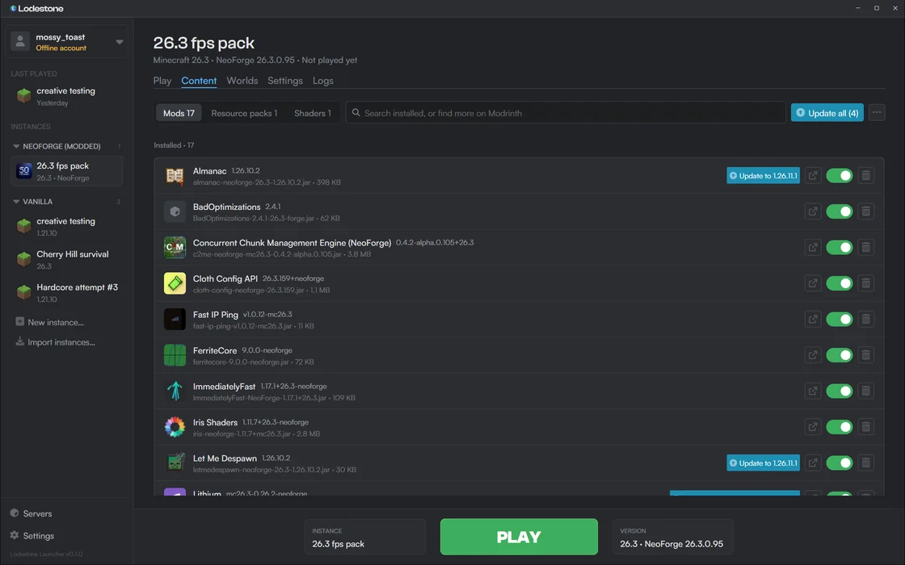
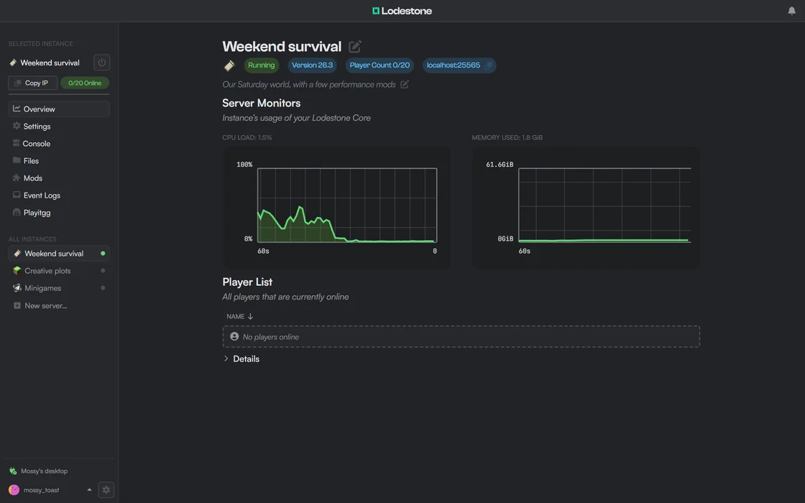
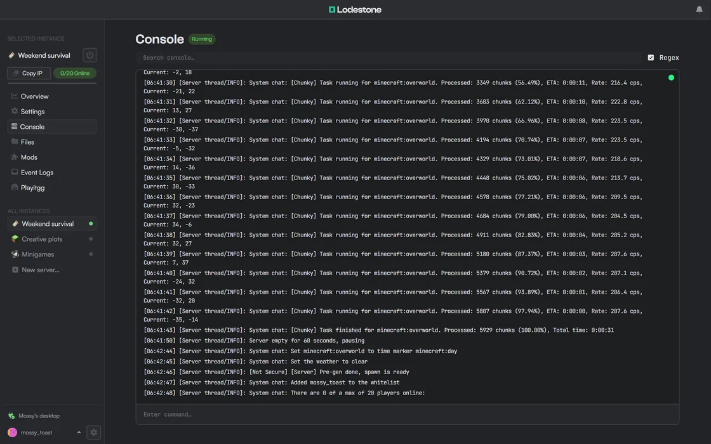
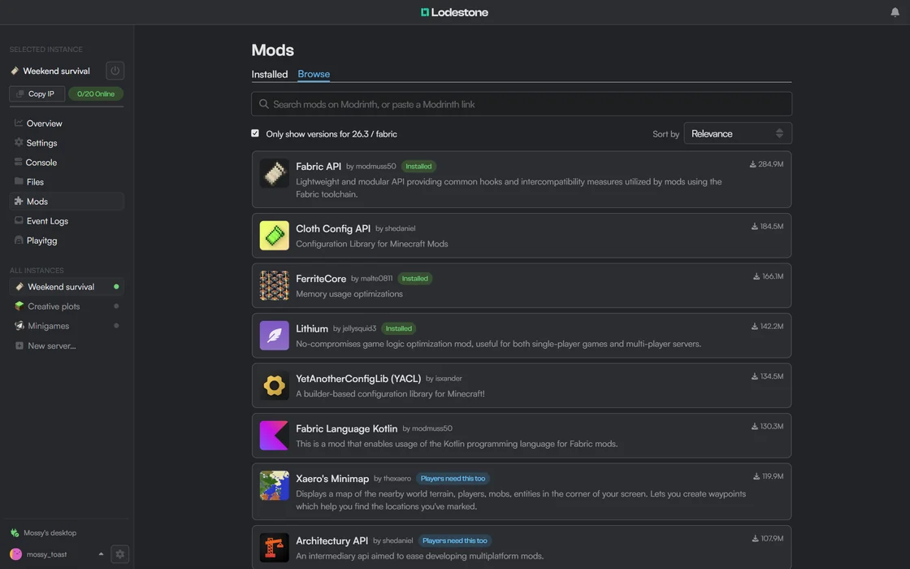

<p align="center">
  <a href="https://www.lodestone.cc/"></a>
</p>

[![Contributors][contributors-shield]][contributors-url]
[![Issues][issues-shield]][issues-url]
[![Build][workflow-shield]][workflow-url]


# Lodestone

From your first world to your own server. Lodestone makes free, open source tools for playing and hosting Minecraft:

| | |
| --- | --- |
| **[Lodestone Launcher](#lodestone-launcher)** | A fast Minecraft launcher with modpacks, mods, shaders and resource packs from Modrinth built in. |
| **[Lodestone Host](#lodestone-host)** | Run Minecraft servers on your own machine and look after them from a dashboard in your browser. |
| **[Lodestone CLI](#lodestone-cli)** | Install and update Lodestone Host, then run your servers from the terminal. |

Get started at [https://www.lodestone.cc](https://www.lodestone.cc/).

## Lodestone Launcher

Deceivingly simple, incredibly powerful. Lodestone Launcher is a free, open source launcher for Minecraft, with modpacks, mods, shaders and resource packs from Modrinth in one fast app.



<p>
  
  
</p>

Keep every instance tidy and switch between them in a click. The launcher keeps itself up to date.

### Installation

- On Windows 10 and 11, download [`LodestoneLauncherSetup.exe`](https://github.com/Lodestone-Team/lodestone/releases/download/launcher-latest/LodestoneLauncherSetup.exe), or get it from [https://www.lodestone.cc/launcher](https://www.lodestone.cc/launcher). It installs for your user, without administrator rights.
- A macOS version is coming soon.

## Lodestone Host

Your Minecraft server, on your own machine. Lodestone Host, previously called Lodestone Core, is a free, open source server manager. Start a server from a modpack, add mods from Modrinth, and look after it all from your browser.



<p>
  
  
</p>

- Vanilla, Fabric, Forge and Paper servers, plus Fabric modpacks from Modrinth.
- Console, files, and live CPU and memory use for every server.
- Friends can join without port forwarding through [playit.gg tunnels](https://github.com/Lodestone-Team/lodestone/wiki/Playit.gg-Integration).
- Users and permissions for everyone who helps run your servers.
- [Macros](https://github.com/Lodestone-Team/lodestone/wiki/Intro-to-Macro-and-Task) to extend it.
- API keys and a CLI for scripts, bots and agents.

### Installation

Lodestone Host installs and updates with [Lodestone CLI](#lodestone-cli):

1. Download Lodestone CLI for your platform from [https://www.lodestone.cc/host](https://www.lodestone.cc/host) (or [all downloads](https://github.com/Lodestone-Team/lodestone_cli/releases/latest)) and run it.
2. Open the dashboard at [https://www.lodestone.cc/host/app](https://www.lodestone.cc/host/app/) and connect to your machine. Alternatively, you can host the dashboard yourself.

Lodestone CLI is available for Windows (x86_64), Linux (x86_64 and ARM64) and macOS (Apple Silicon). There is no build for Intel Macs.

To use Docker instead, see the [Docker Support](https://github.com/Lodestone-Team/lodestone/wiki/Docker-Support) page.

### Future features
- [ ] Complete [Docker integrations](https://github.com/Lodestone-Team/lodestone/wiki/Docker-Instance) (work in progress)
- [ ] Event viewer

If you have a feature request, let us know by creating an issue.

## Lodestone CLI

Install and update Lodestone Host, then run your servers from the terminal. Scripts and agents get JSON output.

```sh
lodestone_cli login 192.168.1.20          # https and port 16662 by default
lodestone_cli server create --flavour fabric --version 1.21.1 --name survival --wait
lodestone_cli mods survival install fabric-api
lodestone_cli server start survival --wait
lodestone_cli console survival --follow
```

- It does everything the dashboard does: servers, console, players, files, mods, users, macros, playit.gg and more. Run `lodestone_cli <command> --help` for the details.
- For scripts and agents, add `--json` for machine-readable output, and use a limited, expiring API key (`lodestone_cli api-keys create`) instead of your password.
- It is self-contained: download and run the [latest release](https://github.com/Lodestone-Team/lodestone_cli/releases/latest), and it installs, updates and runs Lodestone Host.

See the [Lodestone CLI repository](https://github.com/Lodestone-Team/lodestone_cli) for every command.

## Safety & security

Lodestone Host's core is written entirely in safe Rust, and uses `#![forbid(unsafe_code)]`. However, **we can't guarantee the safety of the crates and binaries we link to**, as those may use unsafe Rust.

We build Lodestone with security as a top priority. Most of the safety-critical code, such as login and permissions management, has been tested thoroughly, but **no formal security audit has been done for any part of Lodestone.**


## Contributing

Lodestone is still new, and we'd like to hear your feedback. If you have a suggestion, open a GitHub issue or talk to us on our [Discord](https://discord.gg/PkHXRQXkf6).


## License

The Lodestone project uses the GNU Affero General Public License v3.0. See our `LICENSE` file for details.

Lodestone and all its components (launcher, Host, CLI, dashboard, macros, etc.) are free for personal use, forever. 

You may use Lodestone for commercial purposes, but you must disclose the source code of any modifications you make to Lodestone. You must also disclose the source code of any software that uses Lodestone's API.

Lodestone team provides absolutely no warranty or guarantee for the software.

For an alternate (non-AGPL) license, contact us by either raising an issue or joining our [Discord](https://discord.gg/PkHXRQXkf6).


## Team

Lodestone wouldn't be here without our contributors. You can see the [team on GitHub](https://github.com/orgs/Lodestone-Team/people).

## Support us

Lodestone is maintained by a team of university students and makes no profit. If you'd like to support development, you can [buy us a coffee](https://ko-fi.com/lodestone_team).

## Have questions?

Check our [FAQ](https://github.com/Lodestone-Team/lodestone/wiki/FAQ) for more information.

You can also join our [Discord](https://discord.gg/PkHXRQXkf6) to ask questions and get help setting up Lodestone.


<p align="right">(<a href="#top">back to top</a>)</p>

<!-- MARKDOWN LINKS & IMAGES -->
<!-- https://www.markdownguide.org/basic-syntax/#reference-style-links -->

[contributors-shield]: https://img.shields.io/github/contributors/Lodestone-Team/lodestone?style=for-the-badge
[contributors-url]: https://github.com/Lodestone-Team/lodestone/graphs/contributors

<!-- [forks-shield]: https://img.shields.io/github/forks/github_username/repo_name.svg?style=for-the-badge
[forks-url]: https://github.com/github_username/repo_name/network/members
[stars-shield]: https://img.shields.io/github/stars/github_username/repo_name.svg?style=for-the-badge
[stars-url]: https://github.com/github_username/repo_name/stargazers -->

[issues-shield]: https://img.shields.io/github/issues/Lodestone-Team/lodestone?style=for-the-badge
[issues-url]: https://github.com/Lodestone-Team/lodestone/issues
[workflow-shield]: https://img.shields.io/github/actions/workflow/status/Lodestone-Team/lodestone/ci.yml?branch=main&style=for-the-badge
[workflow-url]: https://github.com/Lodestone-Team/lodestone/actions/workflows/ci.yml
[license-shield]: https://img.shields.io/github/license/github_username/repo_name.svg?style=for-the-badge
[license-url]: https://github.com/github_username/repo_name/blob/master/LICENSE.txt
[product-screenshot]: images/screenshot.png
